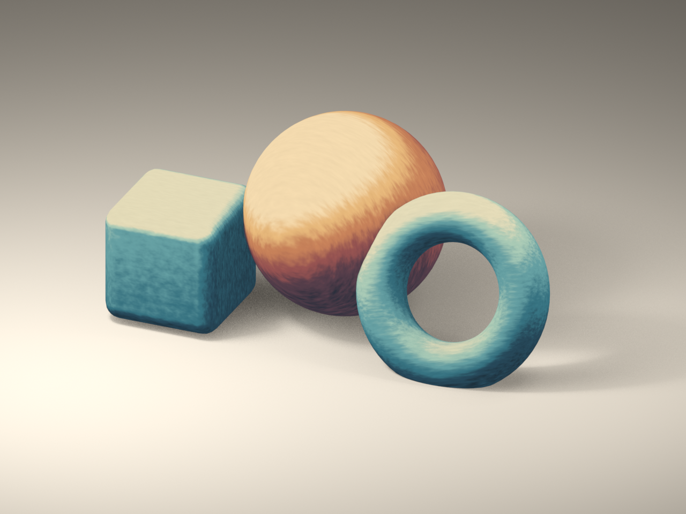

# Procedural painterly material study

Original look-development reference by Runproof Studio. A small scene of three primitives demonstrates a limited pigment palette, irregular lighting boundaries and object-space directional strokes.



[Two-second motion sample](motion.mp4) · [Editable Blender Python source](study.py)

The preview was rendered in **Blender 5.1.1 / Eevee**. The still is 1280 × 960. The motion sample is 640 × 480, 12 fps, 24 frames, without audio. Materials use Diffuse → Shader to RGB, a pigment ramp and procedural noise; they have no image-texture inputs.

To reproduce with Blender 5.1:

```sh
blender --background --factory-startup --disable-autoexec --python-exit-code 1 --python study.py -- --outdir out --animate
```

This produces an editable local `.blend`, PNGs, MP4 and a verification JSON. The reference covers rigid primitives; a customer's scene, deformation, Cycles compatibility and production animation stability need separate evaluation. The surface treatment is procedural shading rather than a hand-painted texture example.

Source is available under the MIT license below. No client assets were used.

## License

Copyright (c) 2026 Runproof Studio

Permission is hereby granted, free of charge, to any person obtaining a copy of this software and associated documentation files (the "Software"), to deal in the Software without restriction, including without limitation the rights to use, copy, modify, merge, publish, distribute, sublicense, and/or sell copies of the Software, and to permit persons to whom the Software is furnished to do so, subject to the following conditions:

The above copyright notice and this permission notice shall be included in all copies or substantial portions of the Software.

THE SOFTWARE IS PROVIDED "AS IS", WITHOUT WARRANTY OF ANY KIND, EXPRESS OR IMPLIED, INCLUDING BUT NOT LIMITED TO THE WARRANTIES OF MERCHANTABILITY, FITNESS FOR A PARTICULAR PURPOSE AND NONINFRINGEMENT. IN NO EVENT SHALL THE AUTHORS OR COPYRIGHT HOLDERS BE LIABLE FOR ANY CLAIM, DAMAGES OR OTHER LIABILITY, WHETHER IN AN ACTION OF CONTRACT, TORT OR OTHERWISE, ARISING FROM, OUT OF OR IN CONNECTION WITH THE SOFTWARE OR THE USE OR OTHER DEALINGS IN THE SOFTWARE.

